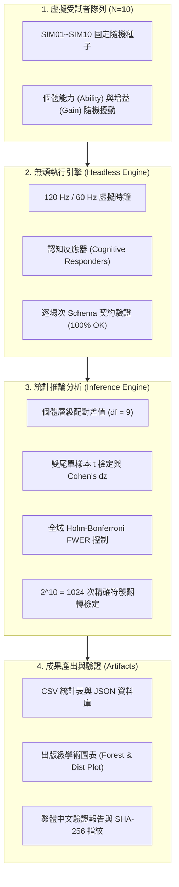
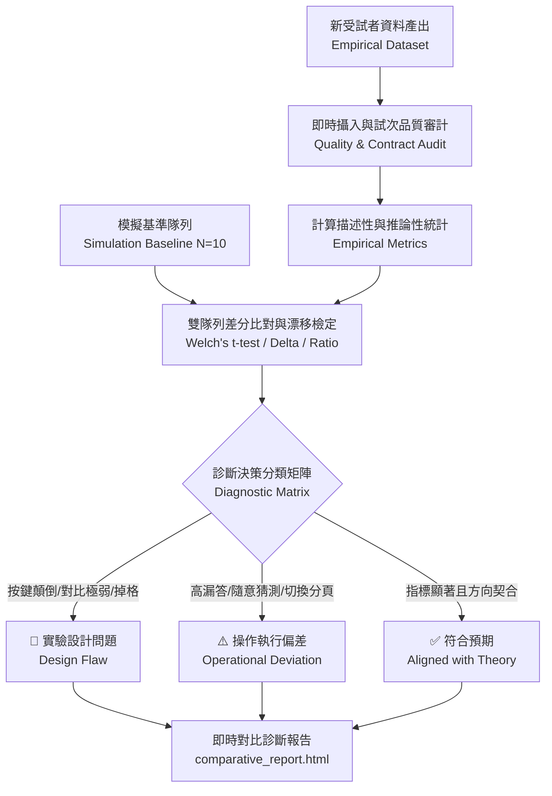

# 認知實驗電池模擬、統計推論與實驗設計驗證技能 (cognitive_task_pilot_skill)

## 一、概述 (Overview)

本技能定義了**朱國大醫師 (Kwo-Ta Chu, MD, PhD)** 認知神經科學實驗室之核心標準作業程序：**「無頭虛擬受試者蒙地卡羅模擬 ➔ 試次狀態機與資料規格審計 ➔ 描述性與推論性統計分析 ➔ 實驗設計敏感度診斷與參數修訂」**。

在認知心理學與計算神經科學專案中，新設計之實驗範式（如注意捕捉、工作記憶掃描、跨感官結合、多物件追蹤等）在投入昂貴之真人實驗或臨床試驗前，必須先經由**虛擬受試者隊列 (Virtual Cohorts)** 進行端到端之數值模擬，以驗證：
1. **刺激呈現與反應契約 (UI/Trial Contracts)** 是否 100% 符合資料規格且無遺失值。
2. **統計推論管線 (Statistical Inference Pipeline)** 之數值穩定度、自由度計算與多重比較校正是否精確。
3. **實驗設計敏感度 (Design Sensitivity)**：及早診斷天花板效應、地板效應、刺激呈現時間精度（如 16.67 ms 極短暫刺激與螢幕垂直同步掉格）與試次數量是否足夠。

> [!IMPORTANT]
> **資料來源隔離原則 (Data Provenance Isolation)**：  
> 所有模擬數據必須明確標註 `data_source: 'simulation'` 與 `simulation_provenance.ui_executed: false`。分析管道中須具備嚴格的資料隔離過濾器，確保模擬數據絕不污染真人研究資料庫，且報告中必須註明「本結果僅為計算模型與流程檢核，不可作為人體實徵結論」。

---

## 二、認知電池模擬架構 (Simulation Architecture)



### 1. 虛擬受試者參數模型
- **受試者代號**：`SIM01` 至 `SIM10`。
- **個體能力擾動**：$\text{Ability}_i \sim \mathcal{U}(-0.08, +0.08)$，模擬一般族群之基準反應時間與命中率變異。
- **效應增益擾動**：$\text{Gain}_i \sim \mathcal{U}(0.75, 1.25)$，模擬個體對特定認知干擾（如 Flanker 干擾、返回抑制、促發效應）之敏感度差異。
- **無母數種子配置**：$\text{Seed}_{i, \text{task}} = \text{BaseSeed} + 10 \times i + \text{TaskIndex}$，確保跨平台 100% 可重現。

### 2. 認知反應器 (Cognitive Responders) 設計準則
- **狀態機響應**：精確匹配任務之輸入型態（`buttons`, `slider`, `text`, `keypad`, `touchLocation`）。
- **條件鍵值對齊 (Condition Audit)**：在擷取試次條件時，必須核對任務內部之實際變數命名（例如：A03 為 `c.compat === 'incompatible'`；A10 為 `c.validity === 'cued'`；A07 為 `c.frame_size`）。
- **試次層級雜訊（必要）**：每個 RT 加高斯雜訊（專案用 SD 40 ms），正確率以機率而非寫死；否則每位 SIM 的 summary 完全相同（SD = 0），統計不可估計。
- **條件欄位以實際 plan 為準**：例如 A12 用 `c.trial_number`（沒有 `trial_index`）；同一試次的多個 `choice` 題（察覺／形狀／位置）要依 `req.options` 分辨。
- **禁止補寫 summary**：模擬 session 的 summary 必須是 `summarize` 原樣輸出。缺少的假說指標應修 `summarize` 與 `paradigms/<ID>.md` §6，不可在模擬中注入（真人資料不會有那個鍵）。
- **組間設計要真的分組**：例如 M08 必須同時有 control 與 misled（專案以 SIM 奇偶分派），並使用每人題數足夠的 preset（M08 demo 每人只有 1 題標準測驗，不可用）。

---

## 三、統計推論分析規範 (Statistical Inference Standards)

在朱國大醫師的計算神經科學實驗室規範下，本技能強制執行以下統計標準：

### 1. 個體層級配對檢定 (Subject-level Paired Contrasts)
- 嚴格以「受試者個體平均」為分析單位（$N=10$），**嚴禁使用 Trial 總數膨脹樣本數**。
- 每位受試者只取最新一場有效完成資料，且只合併同一 cohort（研究、作業版本、platform、fidelity、設定；seed／participant_id／group 除外）。
- 檢定自由度為 $df = N - 1$。**$N < 2$ 或受試者間零變異時 $t$、$p$、$d$ 不可估計（NaN）**，不得回報 $p = 0$ 或 $t = \pm\infty$。
- 設計類型由登錄表 `design` 決定：`one_sample`（預設）；`between`（如 M08：`groups` 兩組 Welch t 與組別標籤精確置換）；`proportion`（如 A12：每人一個 0/1，只報比例與 Wilson 95% CI）。
- 登錄表的 `dvKey` 不存在於 summary 時，**不得自動改用其他欄位**。
- 標準化效應量計算配對 Cohen's $d_z$：
  $$d_z = \frac{\bar{D}}{\text{SD}_D}$$
  其中 $\bar{D}$ 為個體對比差值之平均，$\text{SD}_D$ 為差值之樣本標準差（$ddof = 1$）。

### 2. 嚴格控制全域家族型錯誤率 (FWER)
- 當一次檢定多項假說時（如記憶模組 6 項、全電池 32 項或 35 項），採用 **逐步下降 Holm-Bonferroni 校正法 (Step-down Holm-Bonferroni Method)**：
  $$p_{(k)}^{\text{adjusted}} = \max_{j \le k} \min\left(1, (m - j + 1) \cdot p_{(j)}\right)$$
  其中 $m$ 為檢定假說總數，$p_{(1)} \le p_{(2)} \le \dots \le p_{(m)}$ 為排序後之原始雙尾 $p$ 值。
- Holm 家族只包含可估計的檢定（$m$ = 可估計數）。
- 模型支持準則：可估計，且 $\text{Estimate} \times \text{ExpectedDirection} > 0$ 且 $p_{\text{holm}} < 0.05$。在模擬資料上，這只代表管線能找回反應器植入的效應，不代表設計有效。
- 實作：`scripts/pilot_stats.py`（`select_sessions`、`test_hypothesis`、`holm`）；網站對應 `web/js/app/pilot-analysis.js`。

### 3. 精確符號翻轉無母數置換檢定 (Exact Sign-flip Permutation)
- 針對小樣本（$N=10$）的對稱分佈假設進行敏感度檢核：
  枚舉 $2^{10} = 1024$ 種符號翻轉向量 $s \in \{-1, +1\}^{10}$，計算置換均值高於或等於實測均值之比例：
  $$p_{\text{signflip}} = \frac{1}{1024} \sum_{s} \mathbb{I}\left(|\text{mean}(s \odot D)| \ge |\bar{D}| - 10^{-12}\right)$$

---

## 四、35 項認知作業實徵基準與實驗設計優化指引

全套認知測驗電池涵蓋 35 個獨立任務（記憶模組 M01–M09，注意力模組 A01–A26）。詳細數值基準與實徵數據請參閱 [`references/task_benchmarks_and_design_guidelines.md`](references/task_benchmarks_and_design_guidelines.md)。以下為核心設計原則與診斷摘要：

### A. 記憶認知作業模組 (M01–M09)
1. **M01 (Sperling Iconic Memory 視覺圖像記憶)**：
   - *理論*：初級視覺皮質瞬時高容量非語意表徵隨 ISI 衰退。
   - *優化*：音訊提示在網頁端可能存在 20–50 ms AudioContext 解鎖抖動；應預載緩衝區或輔以周邊視覺箭頭線索。
2. **M02 (Suffix Effect 聽覺優勢與末端綴詞效應)**：
   - *理論*：前聽覺儲存庫 (PAS) 之時間抗衰退優勢與綴詞干擾。
   - *優化*：讀唇條件需使用高解析度真人發音嘴形影片，並在試驗前執行嘴形辨識校準。
3. **M03 (Continuous Distractor & Ratio Rule 連續干擾比率定律)**：
   - *理論*：SIMPLE 時間區辨性模型，回憶機率取決於 $\log(\text{IPI}/\text{RI})$。
   - *優化*：擴充對數比值階梯至 4 組階層，以完整擬合非線性神經動力學流形。
4. **M04 (Brown-Peterson PI Release 前攝干擾累積與釋放)**：
   - *理論*：同語意範疇造成干擾堆疊，切換範疇時回憶顯著反彈。
   - *優化*：心算倒數任務應設定強制節奏，防止受試者隱蔽複誦單詞。
5. **M05 (Sternberg Memory Scanning 記憶掃描)**：
   - *理論*：短期記憶循序竭盡搜尋（斜率基準 $+30\sim +45\text{ ms/item}$）。
   - *優化*：納入反應時間 Ex-Gaussian 分解（$\mu, \sigma, \tau$），區分神經掃描速度與決策尾部。
6. **M06 (Generation Effect 生成效應)**：
   - *理論*：產生字詞相較於閱讀字詞具備深層語意編碼優勢（$d' > 0.8$）。
   - *優化*：中文產生提示詞需校正前向聯想強度，避免單詞過於直覺。
7. **M07 (Spacing Effect 間隔複習優勢)**：
   - *理論*：分散練習降低習慣化，提升檢索路徑多樣性。
   - *優化*：確保 Full preset 每清單包含足夠間隔槽位（8–12 槽位），防止短間隔促發干擾。
8. **M08 (Eyewitness Misinformation 目擊者誤導資訊)**：
   - *理論*：事後誤導資訊干擾原始記憶檢索；修正測驗揭示底層記憶殘留。
   - *優化*：事後敘述閱讀須設定最低凝視停留時間（Dwell Time），確保資訊編碼成功。
9. **M09 (Implicit Priming 內隱與外顯記憶分離)**：
   - *理論*：殘詞補全展現知覺促發，不受語意深度加工顯著影響。
   - *優化*：嚴格限制每題作答時限（< 3000 ms），預防受試者轉向外顯猜測策略。

### B. 注意力空間與時序模組 (A01–A26 精要)
- **極短刺激呈現精度 (A10, A26)**：16.67 ms 刺激高度依賴螢幕刷新率。60 Hz 螢幕恰好為 1 幀，120 Hz 為 2 幀。必須在實驗啟動前強制審計垂直同步 (VSync)，自動剔除掉格試次。
- **無注意視盲負荷門檻 (A12)**：動態彈跳追蹤之黑白球數量必須維持在 3 白 3 黑以上，確保工作記憶充分飽和。
- **動態追蹤極限速度 (A17)**：採用自適應階梯法（PEST）逼近 80% 正確率臨界角速度（常模基準 $5\sim 12^\circ/\text{s}$）。
- **注意瞬脫時間動態 (A06, A21)**：確保 Lag 1 具備完整豁免（Lag-1 Sparing），Lag 2/3 呈現顯著注意力瓶頸。

---

## 五、標準化作業指引與可重現執行腳本 (Execution Playbook)

本技能在目錄 `scripts/` 中提供了四個標準化模組：
1. **模擬引擎模板**：[`scripts/simulate_battery_template.mjs`](scripts/simulate_battery_template.mjs)
2. **統計推論分析模板**：[`scripts/analyze_battery_template.py`](scripts/analyze_battery_template.py)
3. **數位指紋核算模板**：[`scripts/verify_battery_template.py`](scripts/verify_battery_template.py)
4. **即時實測比對與漂移診斷引擎**：[`scripts/compare_empirical_pilot.py`](scripts/compare_empirical_pilot.py)

### 執行工作流

```bash
# 以下為專案（2026 Attention and Memory Paradigm）內的腳本；本技能 scripts/ 內為對應模板。
# 步驟 1: 執行虛擬受試者無頭模擬
node scripts/simulate-battery-pilot.mjs

# 步驟 2: 統計推論分析、Holm 校正與圖表
python scripts/analyze_battery_pilot.py

# 步驟 3: 重寫並驗證 SHA-256 清單（只在重新分析後用 --write；不加參數即為驗證）
python scripts/verify_battery_pilot.py --write
python scripts/verify_battery_pilot.py

# 步驟 4: 重建網站面板的預置模擬基準 web/data/simulation-baseline.json
node scripts/build-simulation-baseline.mjs
```

### 必備生成產物結構
完成後之資料夾應包含以下標準結構：
```
output/battery-pilot-10/
├── sessions.json                    # 完整場次 JSON 資料庫 (含 data_source: simulation)
├── trials.csv                       # 逐試次明細 CSV
├── execution-audit.json             # 場次執行健康度與 Schema 驗證審計
├── profile.json                     # 執行環境、軟體版本與假說通過統計
├── inferential_metrics.csv          # 推論統計指標總表 (t, p, p_holm, Cohen's dz, sign-flip)
├── descriptive_statistics.csv       # 條件層級描述性統計 (Mean, Median, SD, SEM, 95% CI)
├── <TASK>_participant_summary.csv   # 各作業個體受試者摘要表
├── figures/                         # 出版級視覺化圖表目錄
│   ├── fig_battery_forest.png       # 32 任務效應量森林圖
│   └── ...                          # 各模組個體散點與平均值對比圖
├── report.html                      # 互動式學術驗證網頁報告 (繁體中文)
├── report.md                        # Markdown 格式學術總結報告
└── SHA256SUMS.txt                   # 全檔案 SHA-256 數位簽章清單
```

---

## 六、新受試者即時數據攝入、模擬基準差分比對與實驗漂移診斷 (Real-Time Ingestion & Drift Diagnosis)

在 Pilot Study 實徵試驗階段，隨時可能由線上平台或實驗室終端產出新受試者資料（如 1 位或少數數位受試者）。**本技能提供即時攝入 (Real-Time Ingestion)、即時推論統計與「模擬基準差分比對 (Simulation-to-Empirical Differential Diagnosis)」之自動化分析機制。**



### 1. 為何需要與 Simulation 基準對照？
- **模擬基準 (Simulation Baseline)**：反應器作者寫入的效應在無頭時鐘下的結果。它**不是實徵常模，也不是黃金標準**；效應大小是設定值，只能用來確認流程與計分方向。
- **實測數據 (Empirical Data)**：包含人類受試者認知疲勞、注意力波動、瀏覽器/螢幕硬體差異與按鍵反應延遲。
- **對照價值**：藉由比對實測效應與模擬基準，能第一時間發掘：
  1. 計分或條件標籤是否可能有誤（例如按鍵對應顛倒導致效應**顯著**反向；需 N ≥ 2 且 p < .05）。
  2. 實驗操作過程是否有異常偏差（例如受試者隨意亂按、大量超時漏答、中途切換瀏覽器視窗）。

### 2. 實驗設計異常 vs 操作執行偏差：自動診斷決策矩陣 (Diagnostic Matrix)

| 異常徵候 (Symptom) | 檢測門檻與指標 | 根本原因診斷 (Root Cause Classification) | 臨床／實驗室處置建議 (Actionable Remediation) |
| :--- | :--- | :--- | :--- |
| **效應方向反轉**<br>(Sign Inversion) | $\text{Mean}_{\text{emp}} \times \text{Dir} < 0$<br>且 N ≥ 2、p < .05 | **🚨 嚴重實驗設計錯誤 (Critical Design Flaw)**<br>通常為按鍵左右對應 (Keypad Mapping) 定義反向，或相容/不相容試次標籤錯誤。 | 立刻檢查該任務之 `scoring` 與按鍵代碼對應，修正後重新標記。 |
| **實測／模擬比率**<br>(Ratio，僅附註) | $\text{Estimate}_{emp} / \text{Estimate}_{sim}$ | **不作診斷**：模擬效應為設定值，比率高低不代表設計對比不足。 | 需要時以文獻效應量做檢定力分析，而非與模擬比較。 |
| **不可估計**<br>(Not Evaluable) | $N < 2$ 或零變異，或 summary 缺主要 DV | **ℹ️ 只能描述** | 收集更多受試者；缺 DV 時修 `summarize`，不換指標。 |
| **天花板效應**<br>(Ceiling Effect) | 整體正確率 $> 98\%$<br>且反應時間變異極小 | **🚨 任務難度過低 (Design Ceiling)**<br>難度太簡單，無法拉開不同認知條件與個體間差異。 | 縮短刺激呈現時間、增加干擾項數量（Set Size）或降低視覺顯著度。 |
| **地板效應**<br>(Floor Effect) | 2AFC/4AFC 正確率 $< 55\%$<br>接近隨機猜答水準 | **🚨 任務難度過高或指導語晦澀 (Design Too Difficult)**<br>受試者無法理解規則或刺激超出知覺閾限。 | 檢查指導語繁中圖文說明，增加練習試次（Practice Trials）與回饋反饋。 |
| **硬體垂直同步掉格**<br>(Hardware Dropped Frames) | 記錄到 `dropped_frames > 0`<br>或 `exposure_error` | **⚠️ 螢幕時序設計問題 (Design Timing Issue)**<br>極短刺激（如 A10 16.7ms、A26 50ms）遭 60Hz 螢幕掉格拉長。 | 於實驗前置頁面加入 VSync 垂直同步自動校準，強制排除掉格試次。 |
| **嚴重超時與漏答**<br>(High Timeout/Omission) | 試次超時率 $> 15\%$<br>(輕度警示為 $> 5\%$) | **⚠️ 操作執行偏差：受試者分心或時限過苛 (Operational)**<br>作答時限 (Timeout) 設定不合理，或受試者注意力中斷。 | 適度放寬最大作答時限（如自 1500ms 寬限至 2500ms），加強倒數提示。 |
| **超速按鍵猜答**<br>(Anticipatory Spamming) | 預期反應率 ($RT < 150\text{ms}$) $> 5\%$ | **⚠️ 操作執行偏差：無效猜答 (Operational)**<br>受試者未經知覺加工即盲目搶按按鈕。 | 加入搶按懲罰延遲（Time-out Penalty），並強制將此試次計為無效。 |
| **瀏覽器分頁切換**<br>(Visibility Lost) | `n_visibility_lost > 0` | **⚠️ 操作執行偏差：實驗中途離座或切頁 (Operational)**<br>受試者跳出測驗頁面，破壞注意力與記憶的連續性。 | 在頁面 `document.visibilitychange` 時發出全螢幕暫停警示，並記錄切頁次數。 |

### 3. 一鍵即時比對指令與使用指引

當產生新受試者檔案（例如單一受試者 `EMP01.json` 或受試者資料夾）時，執行以下指令：

```bash
python "<skill-dir>/scripts/compare_empirical_pilot.py" \
  --empirical "path/to/new_participant_or_sessions.json" \
  --baseline "output/battery-pilot-10/sessions.json" \
  --out "output/pilot-empirical-comparison"
```

#### 生成產物清單：
1. **互動式網頁診斷報告**：[`comparative_report.html`](comparative_report.html)  
   各任務狀態（`EFFECT_REVERSED`、`DESIGN_TOO_DIFFICULT`、`DESIGN_TIMING_ISSUE`、`OPERATIONAL_DEVIATION`、`DESIGN_CEILING`、`NOT_EVALUABLE`、`NO_PRIMARY_DV`、`NORMAL`），附「未檢查的 QC 項目」；狀態取最嚴重者。
2. **雙隊列效應對照森林圖**：[`figures/fig_empirical_vs_simulation.png`](figures/fig_empirical_vs_simulation.png)  
   橫向對比新實測受試者之 Mean ± 95% CI 與模擬基準線，色條依診斷狀態自動標示（藍: 正常, 橘: 輕微偏差, 紅: 嚴重異常）。
3. **推論差分統計表**：[`comparison_metrics.csv`](comparison_metrics.csv)  
   實測與基準估計值、CI、可估計性、Welch $t$／$p$（僅單樣本設計且兩邊 N ≥ 2），以及排除數（重測、其他 cohort、未完成）。
4. **結構化異常警示資料庫**：[`diagnostic_alerts.json`](diagnostic_alerts.json)  
   供實驗室自動化 CI/CD 或儀表板直接解析。

---

## 七、網頁端互動面板整合 (Web Scientist Panel Integration)

本技能的即時分析與雙隊列比對診斷核心，已原生無縫整合至實驗室網站的**「科學家面板」**（[`http://localhost:8080/?lang=zh-TW`](http://localhost:8080/?lang=zh-TW)）中：

### 1. 網站面板操作途徑
1. **進入面板**：於網站工具列點擊研究面板（或由結果頁面進入）。
2. **模式**：`[單一隊列]` 只看實測；`[實測 vs 模擬基準]`（預設）同時顯示模擬基準。
3. **資料選取**（`pilot-analysis.analyzePilots`）：只收完成場次；每位受試者取最新一場；只合併所選的實測 cohort（下拉選單顯示人數／場次）。排除數（未完成／其他 cohort／缺值／重測）顯示在統計表中。
4. **匯入**：「匯入受試者或模擬 JSON」做基本結構檢查，存入本機 IndexedDB 並標記 `imported`；**匯入場次永遠不會被上傳佇列送出**。
5. **預置模擬基準**：「載入預置模擬基準」讀取 `data/simulation-baseline.json`（由 `scripts/build-simulation-baseline.mjs` 產生）。效應為設定值，只供流程對照。
6. **依設計顯示**：單樣本 → t、p、Cohen's d；組間（M08）→ 兩組 N／平均與 Welch t；比例（A12）→ k/n 與 Wilson CI。
7. **品質與方向檢查橫幅**（`pilot-analysis.diagnose`）：方向警示只在指標為假說主要 DV、N ≥ 2、p < .05 且方向相反時出現；QC 只用 summary 中存在的欄位，未檢查項目會列出；沒有警示時顯示「未觸發任何已實作的檢查；這不代表結果符合理論」。
8. **匯出**：「匯出受試者層級 CSV」（經 csvCell 防公式注入）、「匯出分析 JSON」。


